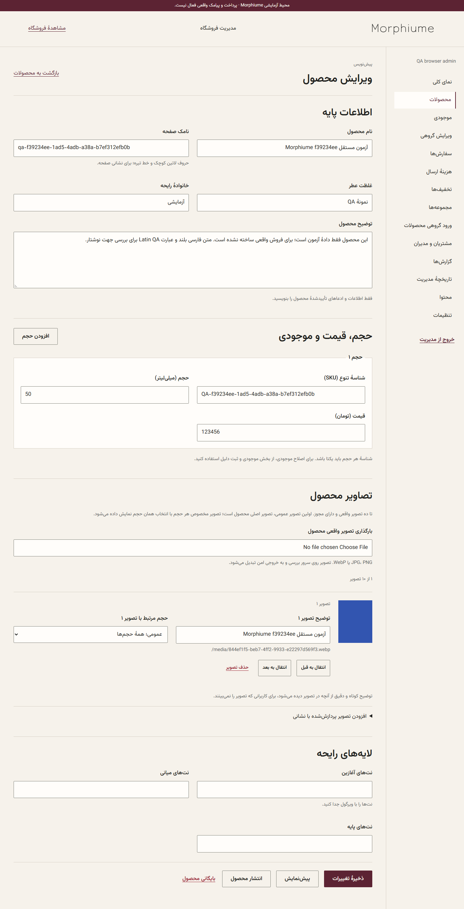
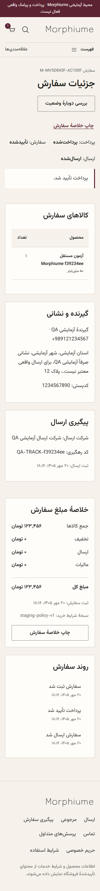

# کار با پنل آزمایشی

در `/admin/login` با حساب آزمایشی خصوصی وارد شوید و TOTP یا کد بازیابی را کامل کنید. رمز ثابت عمومی وجود ندارد. اطلاعات ورود از تنظیمات خصوصی محیط گرفته می‌شوند؛ تصویر URI و recovery code را در گزارش یا Git ذخیره نکنید. نقش هر حساب مسیرهای مجاز پنل را تعیین می‌کند.

محصولات ← محصول جدید: نام و نامک، توضیح و خانوادهٔ رایحه را وارد کنید؛ حجم، شناسهٔ تنوع، قیمت تومان و موجودی اولیه را تعیین کنید؛ تصویر JPEG/PNG/WebP را از انتخاب فایل بارگذاری کنید؛ نت‌ها را اضافه کنید و پیش‌نمایش را ببینید. ابتدا پیش‌نویس ذخیره می‌شود؛ سپس انتشار را صریح تأیید کنید. موجودی اولیهٔ مثبت به مجوز انبار نیاز دارد. خروج با تغییر ذخیره‌نشده پیام ذخیره/نادیده‌گرفتن/ماندن دارد و فرم قدیمی version conflict می‌گیرد.

اصلاح گروهی: تنوع‌ها را در صفحه‌های فهرست انتخاب، قیمت یا تغییر موجودی و دلیل را وارد کنید. پیش‌نمایش اثرها را بررسی کنید، رمزساز تازه را تأیید و همان عملیات را ثبت کنید. ثبت اتمیک است؛ رزرو مشتری از موجودی قابل کاهش محافظت می‌شود. CSV ابتدا dry run و گزارش سطری دارد؛ دادهٔ نامعتبر نیمه‌کاره منتشر نمی‌شود. خروجی CSV سرور دارای کنترل مجوز، تأیید دومرحله‌ای تازه و escape پیشوندهای فرمول است. خروجی بیش از سقف صریح رد می‌شود و فایل ناقص به‌عنوان خروجی کامل ارائه نمی‌شود.

سفارش‌ها: شمارهٔ سفارش و وضعیت را فیلتر کنید، timeline و دریافت مالی مجاز را ببینید، شرکت حمل و رهگیری را ثبت کنید و فقط پس از ارسال، تحویل را ثبت کنید. خلاصهٔ سفارش قابل چاپ است؛ فاکتور مالیاتی قانونی تا دریافت اطلاعات کسب‌وکار ادعا نمی‌شود. یادداشت داخلی در audit با مدیر و زمان حفظ می‌شود و به مشتری نشان داده نمی‌شود.

تنظیمات ارسال برای مالک و نقش مالی است. هزینه و آستانهٔ ارسال رایگان را به تومان وارد کنید؛ آستانه پس از تخفیف ارزیابی می‌شود و می‌تواند غیرفعال باشد. رمزساز تازه، دلیل و نسخهٔ جاری لازم‌اند. تغییر هزینه، سفارش قبلی را عوض نمی‌کند و مشتریِ درحال خرید باید مبلغ تازه را دوباره تأیید کند. پیش‌فرض صفر آزمایشی، سیاست حمل مصوب کسب‌وکار نیست.

بازپرداخت از receipt مشخص شروع می‌شود. مبلغ به تومان و دلیل را وارد کنید؛ برای اقدام حساس TOTP تازه لازم است. انتقال خودکار وجه به PSP وصل نشده است؛ تکمیل دستی فقط با شواهد عملیات انجام‌شده ثبت شود. دریافت دوم یک سفارش را نادیده نگیرید. مرجوعی و تصمیم کیفیتِ بازگشت کالا به انبار از بازپرداخت جدا هستند.

مشتریان/مدیران برای مالک قابل دسترس‌اند؛ نقش، غیرفعال‌سازی و ایجاد حساب مدیر با دلیل ثبت می‌شوند. آخرین مالک فعال قابل غیرفعال‌شدن نیست. محتوا و اطلاعات تماس تنها از دادهٔ تأییدشده منتشر شوند؛ نشان، ضمانت، هزینه یا مهلت حدسی نسازید. قالب فعلی سیاست خرید آزمایشی است.

تصاویر این راهنما از آزمون واقعی مرورگر با دادهٔ مصنوعی‌اند؛ نتیجهٔ خرید مالی آزمایشی است و پرداخت واقعی یا اجرای کل ماتریس پنل را ثابت نمی‌کند. گالری چندگانه/مختص حجم، مناطق منبع‌دار و صفحه‌بندی پیاده شده‌اند؛ دامنهٔ آزمون واقعی هرکدام در TEST_REPORT ثبت می‌شود.
