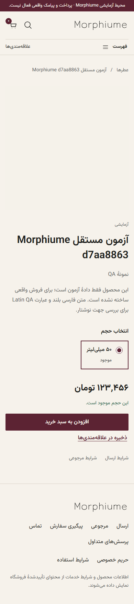

# انتخاب و خرید در محیط آزمایشی

محصول را از کاتالوگ انتخاب کنید، حجم و قیمت تومان را ببینید و به سبد اضافه کنید. سبد مهمان با reload باقی می‌ماند و افزودن به سبد رزرو موجودی نیست. راهنمای رایحه علت پیشنهاد را از ویژگی محصول توضیح می‌دهد؛ پیشنهاد جای اطلاعات معتبر برند را نمی‌گیرد.

در checkout نشانی گیرنده را بنویسید؛ شمارهٔ خریدار با OTP تأیید می‌شود و می‌تواند با شمارهٔ گیرنده متفاوت باشد. کدپستی ده‌رقمی، ارقام فارسی و قالب‌های متعارف شماره پذیرفته می‌شوند. برگشت به مرحلهٔ قبل یا خطای درخواست کد نباید اطلاعات نشانی را پاک کند. در test/staging پیامک واقعی ارسال نمی‌شود؛ اپراتور مجاز آزمون کد را از صندوق خصوصی آزمون دریافت می‌کند.

جمع کالا، تخفیف، ارسال و مبلغ نهایی را بررسی و تأیید کنید. اگر قیمت/موجودی تغییر کرد مبلغ تازه دوباره تأیید می‌شود. صفحهٔ پرداخت آزمایشی انتقال پول ندارد. وضعیت نامشخص به معنی تأیید پرداخت نیست؛ وضعیت سفارش را بررسی کنید و تلاش قبلی تعیین تکلیف می‌شود.

پس از verify سمت سرور، سفارش در حساب همان مشتری دیده می‌شود. رهگیری پس از ثبت مدیر نمایش داده می‌شود. برای لغو یا مرجوعی، درخواست و دلیل را در سفارش واجد شرایط خود ثبت کنید؛ دریافت کالا، بازگشت به موجودی و بازپرداخت مراحل جدا دارند. علاقه‌مندی‌های همین دستگاه با تأیید شما به حساب منتقل می‌شوند. اعلان حساب در محیط آزمایشی داخلی است و رسید پیامک محسوب نمی‌شود.
