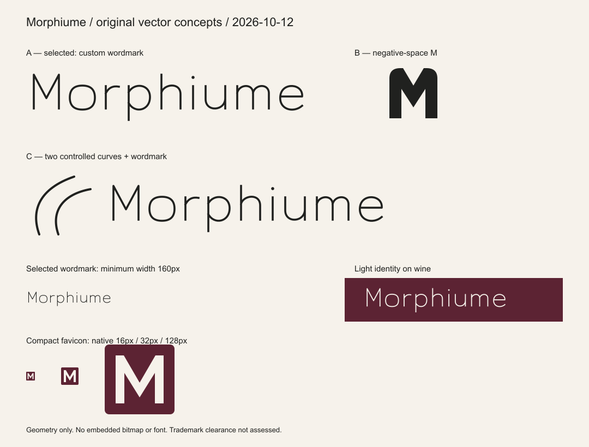

# Morphiume vector identity

Decision date: 2026-10-12. Three original concepts remain in `public/brand` for owner review:

| Concept | Idea | Decision |
| --- | --- | --- |
| A — custom wordmark | Individually drawn letter paths spell Morphiume exactly. Narrow capital M, open r shoulder and restrained circular forms create a quiet rhythm. | **Selected**: the complete brand name is immediately present; geometry needs no installed font. |
| B — negative-space M | Broad shoulders surround a central channel, suggesting an opening/dispersion without drawing a bottle. | Retain for review; too dense as the primary identity and lacks the complete name. |
| C — paired curves + wordmark | Two controlled expanding curves accompany the same custom lettering. | Retain for review; the extra symbol occupies valuable header space and competes with product photography. |

The selected system uses A in full, with a filled compact M derived from its capital proportions for favicon/small contexts. This is one identity system; do not mix the B/C symbols into the storefront.

## Approved assets

- `morphiume-wordmark.svg`: charcoal on light background.
- `morphiume-wordmark-wine.svg`: wine on light background.
- `morphiume-wordmark-light.svg`: bone on wine/charcoal.
- `morphiume-mark.svg` and `morphiume-mark-light.svg`: compact mark on appropriate background.
- `favicon.svg`: bone M on wine tile, suitable for browser identity.
- `morphiume-label.svg`: wordmark centered in generous space, no invented volume, certification, origin or product information.

SVGs contain only vector paths, circles and a favicon rectangle. There is no embedded bitmap, font-dependent text, external URL or script. Each has a viewBox and title. When an asset is inside a named home link, use the link's Persian accessible name and avoid repeating a decorative image announcement. Plain image usage may use `alt="Morphiume"`.

## Sizing and clear space

Full wordmark minimum on-screen width: **160 CSS px**. Below that use the compact M and retain the full brand name in the accessible link label. Wordmark clear space: at least **22 SVG units** (half the lowercase letter height) on every side of visible geometry; at 160px width this is about 7px. Compact mark clear space: at least **16 SVG units** on every side; its 128-unit canvas includes the internal margin.

Compact favicon renders were generated at **16, 32 and 128 px** and visually inspected in the board; the M remains identifiable. The full wordmark was rendered and inspected at 160px. No full-name wordmark is proposed at a 16px width. Label/print geometry is scalable, but real material, ink spread and physical label samples still require owner/printer proofing.

Do not stretch, rotate, add a gradient/shadow, animate letter drawing as a loading requirement, change capitalization or apply Persian letter spacing to the wordmark. Identity is complete when static. No trademark/legal uniqueness assessment has been performed.

Regenerate vectors/tokens with `python docs/design/build_brand.py`. Render/verify using `node docs/design/verify_brand.cjs` with sharp available; the run performed here used the documented bundled runtime and `MORPHIUME_SHARP_PATH`. These commands write only `docs/design` and `public/brand`.
